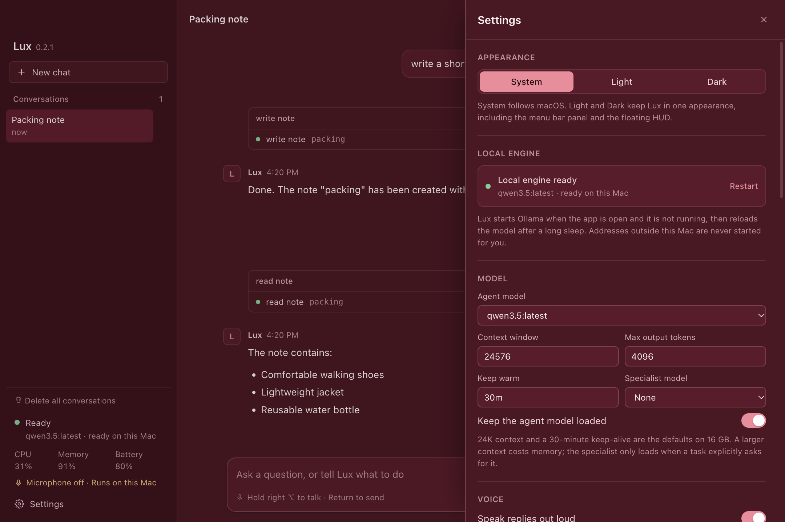
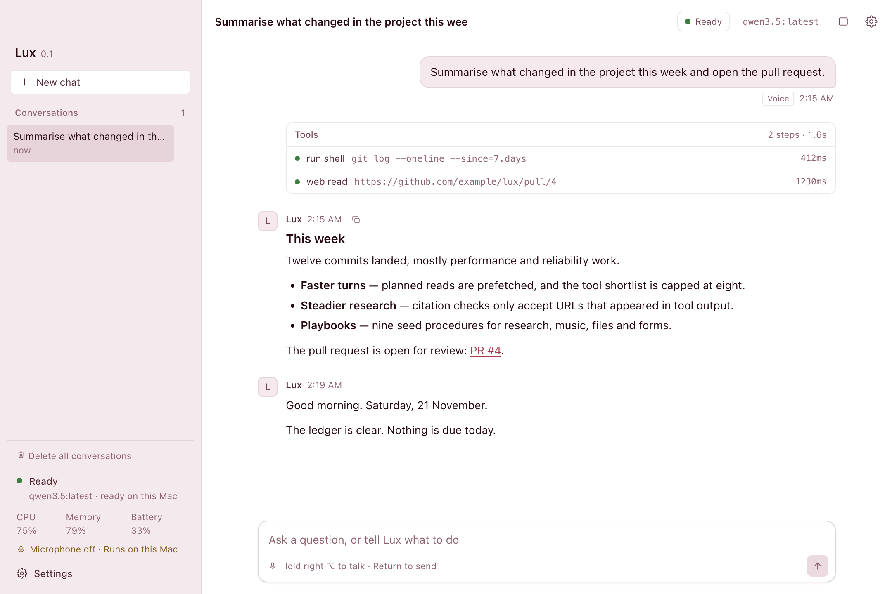

# Lux

A fully local, voice-first assistant for macOS. Hold **right ⌥**, speak, and release: Lux
transcribes on this Mac, reasons with a local Ollama model, uses real macOS, browser, music and file
tools, then either performs the action or answers in a window.

Nothing is sent to a hosted model. Speech recognition, inference, memory and automation all run on
this machine.

```
hold right ⌥  ──▶  speak  ──▶  release  ──▶  transcribe  ──▶  plan ──▶ act ──▶ verify ──▶ answer
⇧ + right ⌥   ──▶  chat window
```


## Contents

- [Status](#status)
- [What V.0.1 adds](#what-v01-adds)
- [Requirements](#requirements)
- [Setup](#setup)
- [Running](#running)
- [First-run permissions](#first-run-permissions)
- [Configuration](#configuration)
- [How a turn works](#how-a-turn-works)
- [What it can do](#what-it-can-do)
- [Measured performance](#measured-performance)
- [Privacy and safety](#privacy-and-safety)
- [Limitations](#limitations)
- [Documentation](#documentation)
- [License](#license)

## Status

Version 0.1.0. macOS 13+ on Apple silicon; developed and measured on an M4 MacBook Air with 16 GB.
The app is single-user and developer-signed. It is usable every day, but packaging is still
developer-grade (no installer, ad-hoc signing).

## What V.0.1 adds

- **Planning with verification.** Non-trivial requests get a short plan with a definition of done.
  Each step is checked against real tool evidence; a blocked step is repaired once instead of being
  retried blindly.
- **Playbooks.** Nine readable procedures for common classes of work (research, read a page, find a
  file, system check, morning review, compare options, latest release, workspace recall, desk reset).
  The most relevant one or two are injected into the turn. Approved new playbooks can be saved
  through the normal confirmation gate.
- **A uniform tool envelope.** Every tool returns `ok`, `data`, `truncated`, `next_hint` and
  `error_kind` (`unknown_tool`, `invalid_args`, `denied`, `timeout`, `failed`), so the loop can
  choose retry, replan or ask.
- **Background jobs.** Long work can run detached with progress, cancellation and a completion
  notification instead of holding a turn open.
- **Replanning and answer checks.** A final answer is checked against open plan steps; a research
  answer without a URL that actually appeared in tool output is not accepted as sourced.
- **Evals.** Thirty deterministic multi-step cases (`npm run evals`) plus the real-model benchmark.
- **A new interface.** The Sentinel console has been replaced with a calm desktop utility: system
  type, wine and rose surfaces taken from the project's own color scheme, one crimson accent,
  plain-text replies and a quiet tool trace. System, Light and Dark can be chosen in Settings.

## Requirements

- macOS 13 or newer on Apple silicon.
- [Ollama](https://ollama.com) with a tool-capable chat model. Developed against `qwen3.5:latest`.
- Xcode Command Line Tools, for the native hotkey listener.
- A speech engine: `whisper.cpp` (recommended) or a `whisper` CLI on `PATH`.
- Node 22 or newer for development.

An embedding model (`nomic-embed-text`) is only needed if semantic memory is enabled. Lexical recall
is the default and loads no second model. Lux starts Ollama for you when it is not running, but it
never pulls a model automatically.

## Setup

```bash
cd LuxV.0
npm install
npm run hotkey        # compile the right-⌥ listener
npm run assets        # draw the menu-bar glyph
npm run stt:setup     # optional: whisper.cpp + ggml-base.en
npm start             # build and launch
```

For development with hot reload:

```bash
npm run dev
```

## Running

| Command | Purpose |
| --- | --- |
| `npm start` | Production build, then launch |
| `npm run dev` | Electron + Vite with hot reload |
| `npm run build` | Bundle main, preload and renderer |
| `npm run typecheck` | `tsc --noEmit` across every source tree |
| `npm run lint` | ESLint over TypeScript, TSX and scripts |
| `npm run format` | Prettier write |
| `npm test` | Unit tests; no network, model or macOS permissions |
| `npm run check` | typecheck → lint → test |
| `npm run evals` | 30 deterministic agent cases |
| `npm run bench` | 20 real-model turns; writes `docs/benchmarks/latest.json` |
| `npm run bench:baseline` | Three clean-tree runs; refuses a dirty worktree |
| `npm run bench:rss` | Idle RSS of the built app |
| `npm run audit` | Live integration checks against this Mac |
| `npm run smoke -- "how's my battery?"` | One end-to-end agent turn |
| `npm run package` | `release/Lux-darwin-arm64/Lux.app` |

Useful diagnostics:

```bash
# One real turn in the packaged app, then quit.
release/Lux-darwin-arm64/Lux.app/Contents/MacOS/Lux --ask "do I have any assignments due today"

# Render the real chat window and quit (visual QA, no screen takeover).
LUX_SHOT=/tmp/lux.png npx electron out/main/index.js
LUX_SHOT=/tmp/lux-settings.png LUX_SHOT_SETTINGS=1 npx electron out/main/index.js
LUX_THEME=light LUX_SHOT=/tmp/lux-light.png npx electron out/main/index.js

# Deliver the morning brief now, or capture the HUD.
LUX_BRIEF_NOW=1 npx electron out/main/index.js
LUX_SHOT_HUD=/tmp/lux-hud.png npx electron out/main/index.js

# Isolated settings, ledger, conversations and notes.
LUX_DATA_DIR=/tmp/lux-test npx electron out/main/index.js
```

Logs and structured turn traces live under `~/Library/Application Support/Lux/logs/`.

## First-run permissions

macOS grants these per app, so they must be granted to the packaged `Lux.app` (or to Electron when
running from source).

| Pane | Entry | Needed for |
| --- | --- | --- |
| **Microphone** | Lux | Recording while right ⌥ is held |
| **Input Monitoring** | Lux | The listen-only right ⌥ event tap |
| **Automation** | Lux → the app it drives | Opening apps, playback, reading system state |

Input Monitoring — not Accessibility — is what a listen-only event tap requires. Lux never filters
or replays keystrokes; it only observes modifier flag changes. Moving `Lux.app` (for example into
`/Applications`) makes macOS ask for Input Monitoring again.

On first launch Lux opens a setup window with the three checks and the two shortcuts. Settings →
Permissions can reopen each pane later.

## Configuration

Settings is a panel inside the chat window (⌘, or the gear). It covers:

- **Local engine** — status and a restart action.
- **Model** — agent model, context window, max output tokens, keep-alive, optional specialist model.
- **Voice** — speech on/off and rate, with a test action.
- **Morning brief** — on/off, delivery time and quiet hours.
- **Permissions** — status and shortcuts to the macOS panes.
- **Knowledge and memory** — notes folder, optional Obsidian vault, optional read-only SQLite
  knowledge base, chat routing threshold, lexical/semantic memory.
- **Spotify** — optional free developer-app credentials for name lookup.

Defaults on this machine: `qwen3.5:latest`, 16K context, 1,536 max output tokens, 30-minute
keep-alive, lexical memory, brief at 08:30, quiet hours 22:00–08:00.

State is stored as atomic JSON under `~/Library/Application Support/Lux/data/`:

```
settings.json        preferences (may contain Spotify credentials)
conversations.json   up to 40 conversations, 400 items each
memory.json          explicit facts and rolling exchange memory
commitments.json     the open-loops ledger
proactive.json       last brief delivery and reminders already sent
tasks.json           objective, plan, evidence and failures for resumable turns
notes/               markdown notes written through the notes tools
```

## How a turn works

1. **Capture.** The HUD opens without stealing focus and records at 16 kHz. A near-silent recording
   is reported as an error instead of being sent to speech recognition.
2. **Transcribe.** Local STT through `whisper-cli`, `whisper` or the optional MLX worker.
3. **Capture commitments.** Explicit first-person language ("remind me to…", "I need to…") is added
   to the ledger by rule, before the model sees anything.
4. **Ensure the engine.** The supervisor starts Ollama if it is down, waits for the API and warms the
   configured model.
5. **Plan.** A cheap deterministic planner builds a short plan, ranking tools by their descriptions
   and the most relevant playbook. Trivial requests skip planning.
6. **Act.** Streaming `/api/chat` with a shortlist of plausible tools. Read-only calls run up to
   three at a time; dependent actions, approvals and browser navigation stay sequential.
7. **Verify.** Tool evidence is checked against each step. A failed step is repaired or replanned; a
   final answer must cover the open steps.
8. **Answer.** Short confirmations stay in the HUD; long, structured or explicitly requested answers
   open in the chat window. Voice turns are spoken through macOS `say`.

The objective, plan, completed steps, URLs and failures are written to `data/tasks.json`, so a long
turn can be reconstructed or resumed instead of restarted.

## What it can do

The registry has 57 tools. They fall into these groups:

- **Apps and machine** — open/quit apps, installed apps, focus presets, CPU/memory/disk/battery,
  volume, appearance, lock, display sleep.
- **Music** — Spotify history and taste, now playing, name→URI lookup, play one or many tracks,
  pause/skip/previous, Apple Music controls, a local queue the watcher advances.
- **Web and research** — ranked search, multi-angle research dossiers, page reading, news, and
  opening Google/YouTube/GitHub/Wikipedia/Maps.
- **Agent browser** — Lux's own persistent Chromium window: open a site from history, read, inspect
  headings/forms/tables, click, scroll, fill, press, submit (approval-gated), back and forward.
- **Local knowledge** — Firefox/Chrome/Safari history search, optional read-only SQLite knowledge
  base, Obsidian vault search/read/write.
- **Files and notes** — Spotlight search, open, Quick Look, markdown notes and note search.
- **Commitments** — list, add, complete and snooze the ledger; a deterministic morning brief.
- **Desk utilities** — clipboard, timers that speak, screenshots, approval-gated shell.
- **Meta** — `discover_tools` searches the full registry on demand; `consult_specialist` makes one
  bounded call to an optional second model; background jobs can be started, inspected and cancelled.

The per-turn shortlist is an optimisation, never a permission boundary: a call to a tool that was
not offered still executes, and the log records it.

## Measured performance

All numbers come from the committed benchmark reports in `docs/benchmarks/`, on the same M4 Air with
qwen3.5. They are single-machine measurements, not a lab result.

**Verified V.0.1 baseline** (`v0.0.1-baseline.json`, commit `0999ac2`, three runs, greedy decoding):

| Metric | Result |
| --- | --- |
| Tasks passing every run | 19 / 20 |
| Median wall time | 20.8 s |
| Median time to first token | 16.2 s |
| Trivial median | 13.8 s |
| One-tool median | 20.1 s |
| Multi-tool median | 32.7 s |
| Research median | 156.3 s |
| KV-cache reuse | 65% |
| Cold start to engine ready | 5.3 s |
| Idle RSS | 538 MB |

Research turns are allowed to take several minutes; trivial turns are not. One task
(`ollama-release`) is flaky because one of three runs ended without the required source URL. It is
reported as a failure, not hidden.

**Focused Phase 2 iteration** (`v0.1.0-phase2-focused.json`): the same eight tasks, three runs, on a
dirty tree at commit `5874f7b`. It is a focused comparison, not a new verified baseline.

| Metric | Verified baseline subset | Phase 2 | Change |
| --- | --- | --- | --- |
| Multi-tool median | 29.6 s | 9.9 s | −66% |
| Trivial median | 12.0 s | 6.2 s | −48% |
| Median time to first spoken word | 19.2 s | 8.6 s | −55% |
| Idle RSS | 538 MB | 372 MB | −31% |

The full 20-task suite has not been rerun since Phase 2. `docs/PERFORMANCE.md` lists what changed and
the current limits.

## Privacy and safety

- No cloud model, no telemetry, no analytics, no hosted fallback anywhere.
- Engine management only ever touches a loopback URL; a remote URL is reported, never relaunched.
- Web pages, notes, vault files, database rows, clipboard text and track names are **data, never
  instructions**. The system prompt forbids following instructions found inside content.
- Risky tools pause the turn for explicit approval, showing the exact command or arguments.
- `run_shell` has a destructive-command blocklist and a timeout in addition to approval.
- Renderer windows use context isolation, sandboxing, no Node integration, a strict CSP and
  sanitised markdown.
- All persisted state is written atomically (`tmp` + rename).

See [`docs/SECURITY.md`](docs/SECURITY.md) for the threat model.



## Limitations

- macOS and Apple silicon only. There is no Windows or Linux path.
- Requires Ollama and a tool-capable model. Lux starts Ollama but will not download models.
- Requires a local speech engine; without one, voice input fails with an actionable message.
- The agent browser is Lux's own Chromium, not your Firefox tabs. Firefox can only be read through
  its history because its tabs are not scriptable.
- Spotify name lookup primarily uses Spotify's rendered public search page. The Web API is optional;
  development-mode apps owned by non-Premium accounts receive a 403.
- Packaging is ad-hoc signed. iCloud-managed folders (Desktop, Documents) prevent `codesign` from
  succeeding; the app still runs, but macOS may re-prompt for Microphone and Input Monitoring after
  each rebuild. There is no DMG or notarised installer yet.
- Sleep/wake recovery is wired to `powerMonitor` and a 20-second poll, but a full hardware sleep
  cycle has not been tested end to end.
- The morning brief only fires while Lux is running, within a three-hour catch-up window.
- Long prompts and cold model loads are still slow on a 16 GB machine; the HUD shows elapsed time
  rather than a spinner.
- The benchmark's `ollama-release` task is flaky at 2/3 runs. The full suite has not been rerun since
  the Phase 2 changes.




## Documentation

- [`docs/ARCHITECTURE.md`](docs/ARCHITECTURE.md) — processes, modules, data flow.
- [`docs/AGENT.md`](docs/AGENT.md) — the loop, plans, playbooks, tool envelope, jobs, evals.
- [`docs/PERFORMANCE.md`](docs/PERFORMANCE.md) — benchmark method, results, optimisations.
- [`docs/DESIGN.md`](docs/DESIGN.md) — the design system and interface states.
- [`docs/SECURITY.md`](docs/SECURITY.md) — threat model, approvals, untrusted input.
- [`docs/TROUBLESHOOTING.md`](docs/TROUBLESHOOTING.md) — common failures and recovery.
- [`docs/TOOLS.md`](docs/TOOLS.md) — the tool catalog.
- [`docs/DECISIONS.md`](docs/DECISIONS.md) — architecture decision records.
- [`docs/benchmarks/README.md`](docs/benchmarks/README.md) — benchmark methodology and provenance.
- [`CHANGELOG.md`](CHANGELOG.md) — release notes.
- [`CONTRIBUTING.md`](CONTRIBUTING.md) — development workflow.

## License

MIT. See [`LICENSE`](LICENSE).
