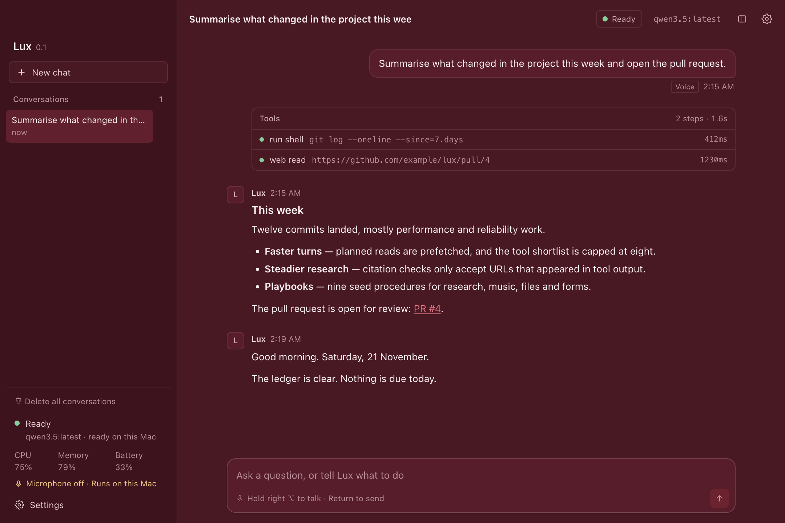
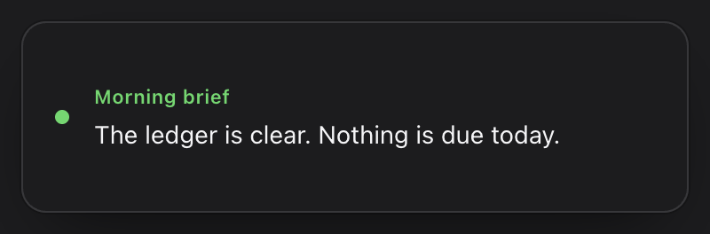

# Lux 0.1

A fully local, voice-first assistant for macOS. Hold **right ⌥** and speak; Lux transcribes on
this Mac, reasons with a local Ollama model, and either performs the action or opens a chat
window with the answer. Press **⇧ + right ⌥** to open the chat directly.

Nothing leaves the machine: speech recognition, inference, memory and automation are all local.

```
hold right ⌥  ──▶  speak  ──▶  release  ──▶  transcribe  ──▶  reason ──▶ act or answer
⇧ + right ⌥   ──▶  chat window
```

## Why it behaves like an assistant

A tool loop is not the same thing as an agent. Three differences do the work here:

- **It owns the objective.** A reply that announces the next step ("Let me check…") or hands it
  back ("Would you like me to open…?") is not accepted as an answer: the turn continues with a
  directive to act, up to twice. The stalled draft is discarded rather than fed back to the model,
  because a small model shown its own deferral writes it again almost word for word.
- **It reads before it asks.** "My spotify", "my courses", "my inbox" resolve to a tool instead of
  an interview about preferences it could look up. Asking is reserved for a real fork.
- **It only offers the plausible tools.** Each turn ranks the registry against the request
  (`shared/tool-router.ts`) and sends the best few plus a small core set. Fewer schemas means a
  faster first token and a sharper choice for a 9B model. A call to a tool that was not offered
  still executes, so a wrong guess about relevance never blocks anything.
- **It can find a capability it was not handed.** `discover_tools` searches the full registry and
  returns the matching schemas on demand. The shortlist is an optimisation, never a boundary.
- **It keeps task state outside the context window.** The objective, plan, completed steps, URLs
  and failures live in `data/tasks.json` (`agent/task-state.ts`). A long turn is reconstructed from
  that record, and an interrupted turn can be resumed instead of restarted.
- **It runs independent reads together.** Read-only tools marked `parallelSafe` execute in bounded
  batches of three; dependent actions, confirmation gates and browser navigation stay sequential.
- **It researches with code, not a chain of guesses.** `research` searches several angles, fetches
  pages concurrently, extracts the passages that match the question and returns a numbered source
  dossier. The model compares and writes; it does not drive five sequential homepage guesses.

A turn that runs out of budget keeps its objective and hands it to the next turn, and the HUD
counts seconds while it works — a silent minute reads as a hang.

## Measured change

The original agent offered all 46 tool schemas on every turn and performed the research task in
**82.6 s** with five sequential `web_read` calls, two failing URLs, and qwen plus the embedding
model resident at the same time. The current agent uses lexical recall by default, six schemas on a
battery question, and one bounded research call.

| Task | Before | Current | Model calls | Tool calls |
| --- | --- | --- | --- | --- |
| "what's my battery at?" | 4.75 s | 5.2 s warm (12.2 s under load) | 2 | 1 |
| research local AI models | 82.6 s | **60.6 s** | 2 | 1 |
| Ollama resident models | qwen + nomic | qwen only | — | — |

These are single-machine measurements on the M4 Air, not a controlled lab. The research answer was
checked against current 2026 sources; the simple turn is dominated by model prefill/generation and
varied by several seconds when the Mac was warm or another GPU client was active. The important
structural change is visible in the logs: the research task no longer spends rounds rephrasing
searches or opening every source it already has excerpts for.

## Commitments and the morning brief

Lux keeps a small, durable ledger of what you say you need to do. It is captured deterministically:
explicit first-person language such as "remind me to…", "don't forget…", "I need to…", "I should…"
and "I'll … tomorrow" becomes an item; questions, negations and passing mentions do not. Due dates
are parsed by rule (today, tonight, tomorrow, weekdays, next week, "in 2 hours", clock times), and
saying the same thing twice does not create a duplicate.

By default, once a day at **08:30** while Lux is running, Lux composes a morning brief from that ledger — overdue, due today, coming up, and open loops with no date — and shows it in the HUD, the chat and a native notification. It never invents an item and never calls a model. Quiet hours (**22:00–08:00** by default) suppress delivery; if the Mac is asleep (or Lux was quit) at 08:30, the brief waits until it wakes or launches, but only within a three-hour window, so opening the lid at 21:00 does not produce a "morning" brief. Both times are editable in Settings → Proactive.

Commitments with a due time also produce a single native reminder when they enter the five-minute window. That path is deterministic: the 30-second scheduler reads the ledger, respects quiet hours and a running turn, and records delivery in `data/proactive.json`; it does not call a model.

**Designed for this Mac:** an M4 MacBook Air with 16 GB. This feature adds no model, no embedding
index and no heavy background work. It is regex capture, date arithmetic, a tiny JSON file under
`~/Library/Application Support/Lux/data/`, and one 30-second timer that does nothing on a normal
tick. The packaged app measured **561 MB total RSS across all its processes (3.4% of 16 GB)** while
idle with this feature running.

## Music

`music_taste` answers "what do I actually listen to" from the Mac itself: Spotify's local play
history, the playlists in rotation, and the current track, with names resolved from Spotify's
public embed pages and cached for 30 days. No account, no token, no API key.

`play_music` plays names, not just ids. Give it "Heat Waves — Glass Animals" and it starts that
track; give it five tracks and it plays the first and queues the rest, advancing them itself because
AppleScript has no queue of its own. A name resolves through four tiers: the local cache, the rest
of the play history, Spotify's public search page rendered in a hidden Chromium window, and finally
the optional Web API. The rendered page is the primary route because it needs **no account, no key
and no Premium** — Spotify's API now refuses development-mode apps whose owner is not a Premium
subscriber with `403 Active premium subscription required for the owner of the app`, which is a
wall no amount of pasting a Client ID can climb on a free account. Reading the history never starts
playback, and a free-account advertisement is waited out rather than skipped over.

## Browsing and local knowledge

Lux has a browser it can actually operate. `browser_open` loads a page in its own Chromium
window and hands the model the readable text and every link; `browser_read` reads what is on
screen now; `browser_inspect` returns headings, buttons, forms, tables, pagination and scroll
position; `browser_click` follows a link by its label after approval; `browser_scroll`, `browser_fill`,
`browser_press` and confirmation-gated `browser_submit` operate the page; `browser_back` returns.
The window keeps its session, so signing in once is enough for later requests.

Firefox cannot be scripted, so a tab there cannot be read — but Firefox's history can. Asking
Lux to "check my assignments" makes it call `site_open`, which finds the exact course-portal URL
that is actually used (not a generic home page), opens it in the Lux window and reads the
assignments from the page — one tool call, because asking a 9B local model to chain search-then-open
reliably is a losing bet.

Two more local sources are wired in:

- **Local knowledge** (`agni_links`, `agni_report`) — events, evidence-scored connections and
  written investigations, read read-only from an optional SQLite database. The path is set in
  Settings → Notes & memory; the tools stay disabled until it is configured.
- **Obsidian** (`vault_search`, `vault_read`, `vault_write`) — the vault Obsidian has open is
  detected automatically from its own registry, so no path needs setting.

## Deleting conversations

Hover a conversation in the rail and press **×** to delete it; **delete all** under the list clears
every stored thread. Deleting the open conversation loads the newest remaining one, or starts a
fresh one, so the window is never left pointing at nothing.

## Reading is headless

The agent's browser runs hidden by default — pages are read without a window appearing and
without stealing focus. It only reveals itself when a page actually asks for a sign-in, then stays
open so you can complete it.

## Diagnostics

Every turn and tool call is appended to:

```
~/Library/Application Support/Lux/logs/lux.log
```

To exercise the *packaged* build from a terminal (the part that differs from running the source):

```bash
release/Lux-darwin-arm64/Lux.app/Contents/MacOS/Lux --ask "do I have any assignments due today"
```

It runs one real turn, prints the tool trace, and quits. `LUX_DEBUG=1` echoes the same log to
stdout. To inspect the proactive surfaces without waiting for 08:30:

```bash
LUX_BRIEF_NOW=1 npx electron out/main/index.js          # deliver the brief now
LUX_SHOT_HUD=/tmp/lux-brief.png npx electron out/main/index.js  # deliver, capture the HUD, quit
LUX_DATA_DIR=/tmp/lux-test npx electron out/main/index.js       # isolated settings, ledger and conversations
```

Each turn also writes a structured record to `logs/turns.jsonl`: the tools offered, every call with
its status, duration and one-line result, nudges, rounds, and whether the turn ran out of budget.
Each model round also records `kind: "model"` with wall time, prompt/eval/load durations, total
prompt tokens and `prompt_eval_cached_count`; `cacheReusePct` is exact on Ollama 0.33.3+ and absent
on older runners. That is the file to read when a turn behaved oddly or feels slow.

### Capability audit

```bash
npm run audit                  # 42 live checks + the full registry against the real Mac
LUX_AUDIT_AUDIO=1 npm run audit  # also play a track and verify Spotify
LUX_AUDIT_GROUP=music npm run audit
```

The audit runs the real integrations (Spotify, browser, history, vault, local knowledge, notes, news), reports
PASS/FAIL/SKIP per tool, writes `logs/audit.json`, and exercises the approval gate by expecting a
denial. It is separate from `npm test`, which covers pure logic and needs no network or macOS
permissions.

## Opening settings

Settings are a sheet inside the chat window, not a separate window. Any of these opens it:

- **⌘,** or the menu **Lux → Settings…** (opens the chat and reveals the sheet)
- The **gear icon** at the top right of the chat window
- The **model chip** next to it (e.g. `qwen3.5:latest`)
- The **mic / privacy line** at the bottom of the rail
- The menu-bar tray icon → **Settings…**

It contains the model picker, the optional specialist and embedding models, context window,
max output tokens, keep-alive, lexical/semantic memory, speech on/off and rate, the permission
statuses, the notes folder, the optional Obsidian vault path, and the optional local knowledge database path.

## Packaging Lux as an app

```bash
npm run package                        # -> release/Lux-darwin-arm64/Lux.app
cp -R release/Lux-darwin-arm64/Lux.app /Applications/
```

The bundle carries the `Lux` name, the app icon, the microphone and Apple Events
usage strings, and the native hotkey helper inside `Contents/Resources/bin`.

This matters for permissions. Running from source (`npm start`) makes macOS treat the
process as **Electron** (bundle id `com.github.Electron`), so Privacy & Security lists
"Electron" — or, when launched from a terminal, attributes the request to the terminal.
The packaged bundle requests access as **Lux** (`com.lux.assistant`).

Ad-hoc signing is attempted and skipped with a warning if it fails. Signing fails on
folders managed by iCloud Drive (Desktop, Documents) because the file provider keeps
re-attaching `com.apple.FinderInfo`, which `codesign` rejects; the app still runs locally.
Rebuilding changes the bundle, so macOS asks for Microphone and Input Monitoring again
until you grant them once per build.

## Permissions (packaged app)

System Settings → **Privacy & Security**:

| Pane | Entry | Needed for |
| --- | --- | --- |
| **Microphone** | Lux | Recording your voice while right ⌥ is held |
| **Input Monitoring** | Lux | The right ⌥ hotkey (a listen-only event tap) |
| **Automation** | Lux → the apps it drives | Opening apps, playback, reading system state |

If Microphone shows no Lux entry yet, open Lux and press **Allow microphone** in the setup
window (or open Settings and click **OPEN** beside Microphone). macOS only adds an app to
that list after the app asks once, and the reason string comes from the bundle's
`NSMicrophoneUsageDescription`.

Because Input Monitoring is recorded against the app's path, moving `Lux.app` (for example
into `/Applications`) makes macOS ask for it again; the microphone grant is by bundle id and
survives the move.

## Requirements

- macOS 13+ on Apple silicon (built and tested on macOS 26 / M-series). This build is tuned for
  the **M4 MacBook Air with 16 GB**; the app's measured idle footprint is 561 MB across all processes.
- [Ollama](https://ollama.com) installed locally with a tool-capable chat model. Lux starts it
  automatically when the app opens and it is not running. The app was
  developed against `qwen3.5:latest`; an embedding model (`nomic-embed-text:latest`) is only needed
  if semantic memory is enabled. Lexical recall is the default and loads no second model.
- Xcode Command Line Tools (for the native hotkey listener).
- A speech engine: `whisper.cpp` (fastest, recommended) or a `whisper` CLI already on `PATH`.

## Setup

```bash
cd LuxV.0
npm install
npm run hotkey        # compile the right-⌥ listener
npm run assets        # draw the menu-bar glyph
npm run stt:setup     # optional: whisper.cpp + ggml-base.en
npm start             # build and launch
```

For development with hot reload:

```bash
npm run dev
```

On first launch Lux opens a welcome window with the three permissions it needs.

## Permissions

| Permission | Why | Where |
| --- | --- | --- |
| Microphone | voice capture, only while right ⌥ is held | Privacy & Security → Microphone |
| Input Monitoring | a *listen-only* event tap for the right ⌥ hold | Privacy & Security → Input Monitoring |
| Automation (per app) | AppleScript actions like quitting Spotify | macOS prompts on first use |

Input Monitoring — not Accessibility — is what a listen-only event tap requires. Lux never filters
or replays your keystrokes; it only sees modifier flag changes.

## What it can do

Ask naturally; Lux picks the tools.

- **Apps** — open/quit apps, list what's installed, switch into study/coding/focus setups
- **Machine** — CPU/memory/disk/battery report, volume, light/dark, lock, display sleep
- **Music** — Spotify search and playback, pause/skip, now playing
- **Web** — open URLs, search Google/YouTube/GitHub/Wikipedia/Maps, fetch headlines
- **Files** — Spotlight search, open files and folders, Quick Look
- **Notes** — write or append markdown notes, search them (and an Obsidian vault if configured)
- **Desk** — clipboard read/write, timers that speak, screenshots, guarded shell commands
- **Commitments** — remembers explicit open loops, parses their due dates, and delivers a quiet
  morning brief at a time you choose

`run_shell` always asks for approval, and a destructive-command blocklist runs before execution.

## The two surfaces





## Architecture at a glance

```
native/hotkey (Swift, CGEventTap)
        │ NDJSON: down / up / chat
        ▼
Electron main ── Session ── Agent loop ── Ollama /api/chat (streaming + tools)
        │            │             ├── tools/ (55 actions, validated, bounded parallel reads)
        │            │             ├── research engine + cached public search
        │            │             └── task state (data/tasks.json)
        │            ├── memory: lexical recall by default; semantic opt-in
        │            └── STT: whisper-cli | whisper CLI | mlx worker
        ▼
HUD window (hold ⌥)                 Chat window (⇧⌥)
```

See `docs/ARCHITECTURE.md` for the full picture, `docs/TOOLS.md` for the tool catalog, and
`docs/RESEARCH.md` for the platform research behind each decision.

## Scripts

| Command | Purpose |
| --- | --- |
| `npm run dev` | Electron + Vite with hot reload |
| `npm start` | Production build, then launch |
| `npm run build` | Bundle main, preload and renderer |
| `npm run typecheck` | `tsc --noEmit` across every source tree |
| `npm test` | Unit tests (routing, recall, concurrency, cache, RSS, task state, validation, WAV) |
| `npm run smoke -- "how's my battery?"` | Headless end-to-end agent run against real Ollama |
| `npm run hotkey` | Recompile the Swift listener |
| `npm run stt:setup` | Install whisper.cpp and a model |

## Troubleshooting

`docs/RUNBOOK.md` covers the common failure modes: hotkey not firing, silent microphone, missing
models, and the first-run permission dance.
